# Architecture

How the personal layout for the Herdr app works.
All diagrams are Mermaid and render on GitHub.

## 1. System overview

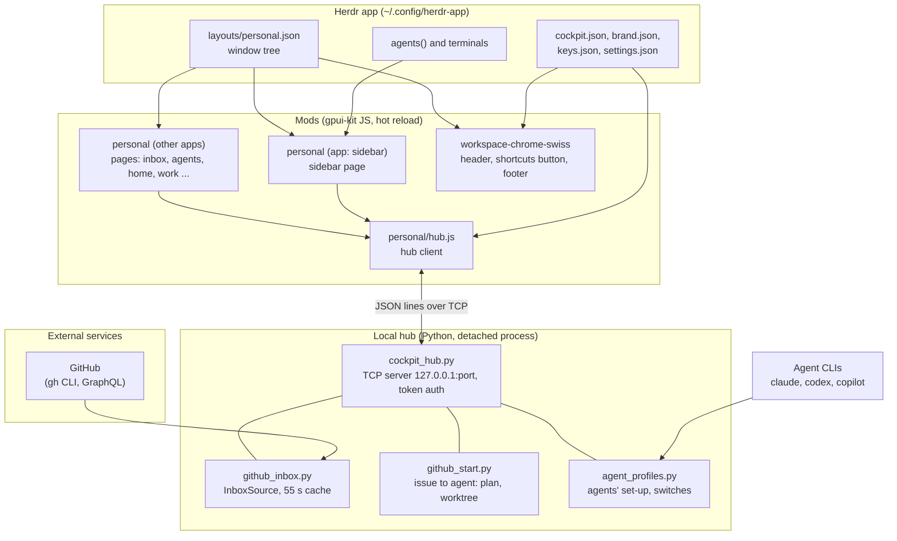

## 2. Layout structure

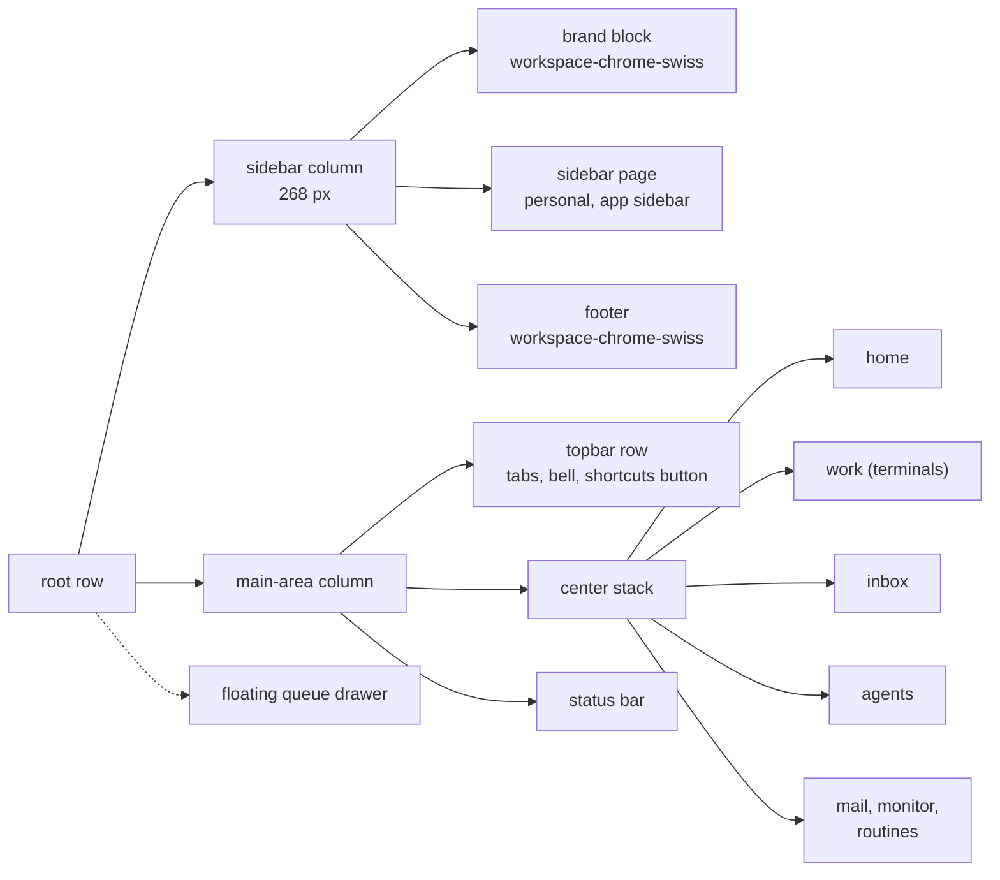

## 3. Hub startup and discovery

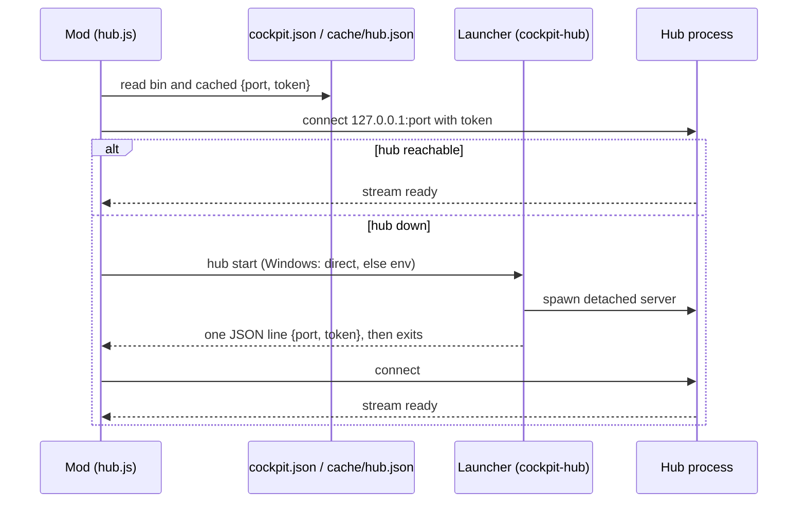

## 4. Protocol operations

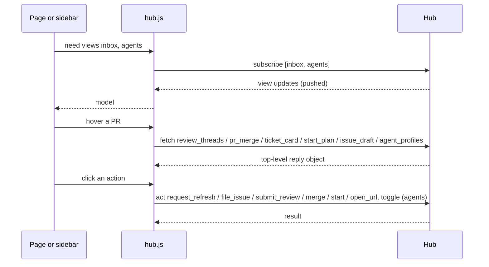

A failing view is isolated, so the other subscribed views keep streaming.

## 5. Inbox data flow

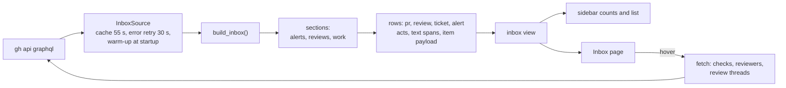

### The inbox's grouping

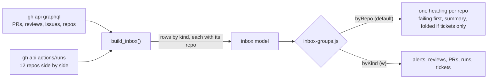

## 6. Reviewing and merging a pull request

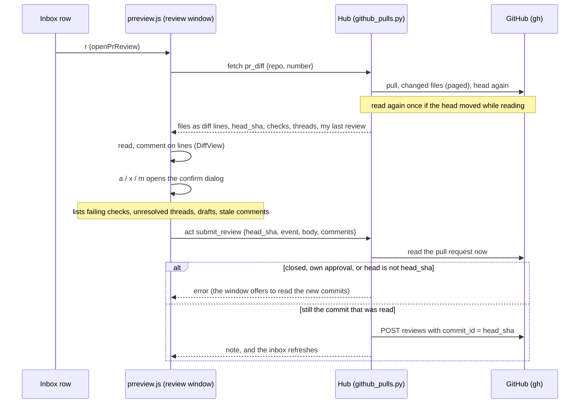

A merge takes the same path with `act merge [{repo, number, head_sha}, method]`.
The hub checks that the pull request is open, not a draft and still at `head_sha`, then calls the merge endpoint with `sha = head_sha`, so GitHub refuses it too if the branch moved in between.
The methods offered come from `merge_choices`: none unless GitHub says the pull request is ready, then the ones the repository allows.

### Checks

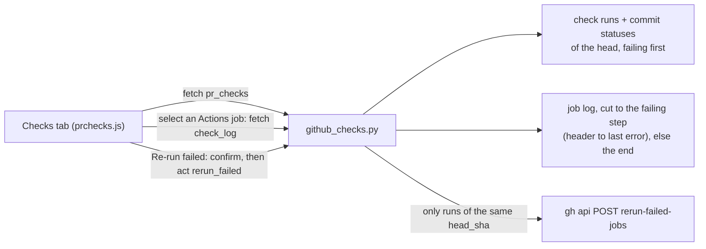

## 7. Agents list with fallback

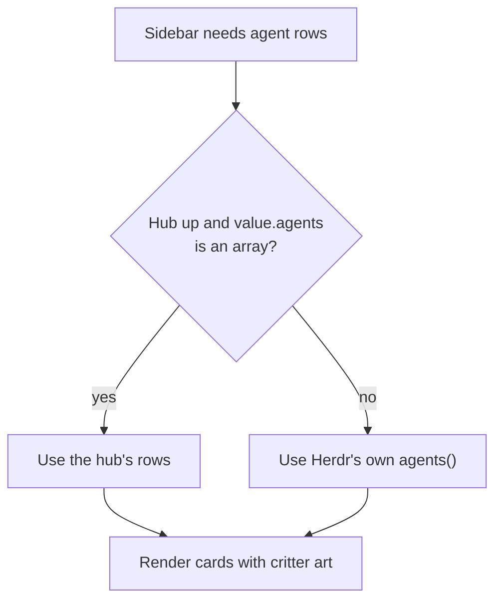

The bundled hub serves a stub for `agents`, so in practice Herdr's own agents are used.

## 8. Branding

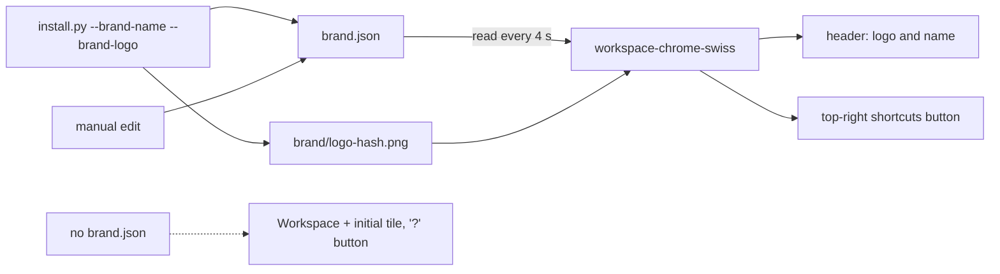

Logo paths must stay inside the Herdr home, and file names carry a content hash because Herdr caches images by path.

## 9. Install flow

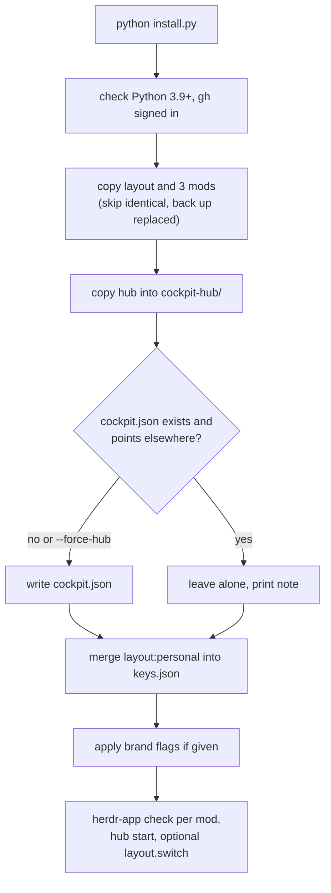

Replaced files go to `<home>/.install-backups/<time>/`.

## 10. Repository map

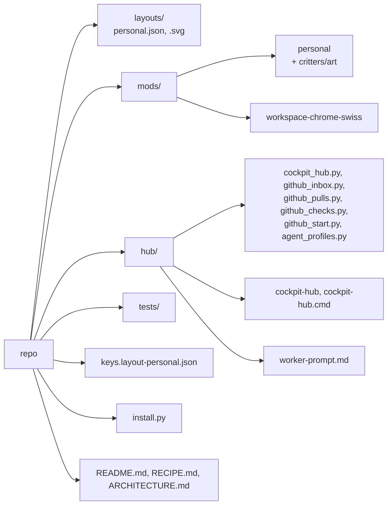

## 11. Platform notes and limits

Windows quirks, the hub's start-up contract and the list of things that must never ship are in `RECIPE.md` under "Watch out".
What is and is not connected is in `README.md`.
