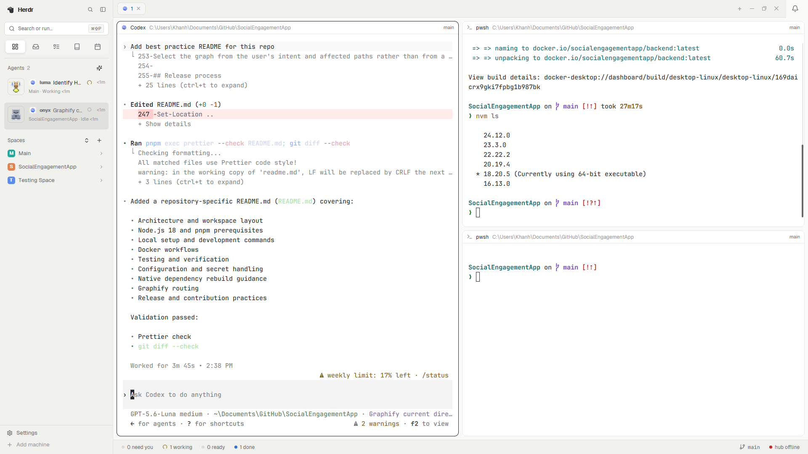

# Khanh Personal Calendar Cockpit

This package adds Khanh's personal Herdr layout with a local, read-only Google Calendar Cockpit service.

## What you see

The window has a custom workspace header, a Cockpit sidebar, agent cards, a work area, and the Meetings view.

The sidebar shows Home, the configured Cockpit apps, live agents, spaces, tabs, and the current calendar context.

The Meetings view shows the current and next event, a list view, a day view, and a week view.

Each event can show its title, time, duration, attendees, response state, Google Calendar link, and video meeting link.

## How it behaves

Working, blocked, done, and idle agents keep the sidebar status colors and navigation behavior.

Selecting an agent focuses its Herdr work, while the agent card keeps its status, duration, project, and activity details.

Selecting Meetings loads the local Cockpit `meetings` view.

The calendar service reads the primary Google Calendar and refreshes the next seven days.

Opening an event launches its Google Calendar link, and joining an event launches its available video link.

Create and edit calendar actions are intentionally disabled in this first version.

## Built from

The layout is `layouts/personal.json`.

The layout uses the `personal`, `personal-swiss`, `workspace-chrome-swiss`, and `herdr-critters` mods in this package.

It also uses Herdr's shipped `tabs`, `files`, and `changes` mods.

The Cockpit client uses `exec`, local file reads, a loopback TCP connection, and the `meetings` view protocol.

The `calendar-cockpit/` folder contains the local Python hub, Windows launcher, OAuth example, and setup instructions.

## Watch out

The layout mod runs trusted local commands and reads files outside its own folder through the Herdr mod API.

The calendar service connects to Google Calendar and stores a refresh token under its local `data/` directory.

Never commit `credentials.json`, `data/token.json`, `cache/hub.json`, or a machine-specific `cockpit.json`.

The Herdr layout installer copies the layout and mods but does not install the separate calendar service automatically.

After installing the layout, install the calendar service from `calendar-cockpit/README.md` and create a local `cockpit.json` for the user's machine.

The layout name is `personal`, so an installation must preserve Herdr's no-overwrite rule and rename it if another layout already uses that name.

## Done when

`herdr-app check` passes for each package mod.

The layout switches successfully with `layout.switch {"name":"personal"}`.

The sidebar renders without missing mod or critter assets.

The calendar hub starts and writes its local `hub.json` address file.

Google OAuth completes through the local browser callback.

The Meetings view displays Google Calendar events and opens event or video links.
