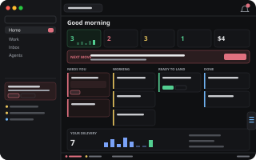

# Personal

A light "Swiss" workspace for the Herdr app.
A left sidebar lists spaces and agents, a slim top bar holds the tabs, and a center area switches between your terminals and pages for the Inbox and Meetings.
A status bar at the bottom counts agents by state.

## What you see

- Left, 268 px wide, background `chrome`: a 46 px brand block (the user's workspace name and logo from `brand.json`, search, sidebar toggle), the sidebar page (page icons, agents, spaces) and a 69 px footer (settings, add machine).
- Top, 42 px: the tab pills, a 52 px notification bell, and a 48 px shortcuts button.
- Center: a stack of pages inside rounded 6 px cards with a 1 px `border`: home, work (terminals), inbox, runbook, todo, meetings, monitor, routines and mail.
- Bottom, 34 px: the status bar.
- Right edge: a floating queue drawer that peeks 44 px and slides out on hover.
- Theme: `paper` in light mode and `graphite` in dark mode, accent `#D71920`, UI font Geist.

## How it behaves

- Agent statuses `working`, `blocked`, `done` and `idle` show as dots and counts in the sidebar, the bell and the status bar.
- The Inbox lists, in order: Alerts (repositories whose default branch CI fails), Reviews (PRs waiting on you), and Work (your PRs and issues).
  Enter opens the row on GitHub, `tab` toggles the details panel, `/` filters, and `R` refreshes.
- The Inbox groups rows by repository: one heading per repo with a summary, repos that need you first, tickets-only repos folded.
  `w` switches to the arrangement by kind.
- Hovering a PR shows its checks, reviewers, labels and unresolved review threads.
- `r` on a PR row opens a review window: the diff with line comments, a Conversation tab, a Checks tab, the verdicts approve (`a`), request changes (`x`) and comment (`m`), and merge (`M`).
  The Checks tab lists check runs and statuses, shows a failed Actions job's failing step, and re-runs the failed jobs after a confirmation.
  Each verdict and merge asks first, listing failing checks, unresolved threads and drafts, and is pinned to the commit that was read.
  Merge is offered only when GitHub says the pull request is ready, in the methods the repository allows.
- Meetings lists the next seven days from Google Calendar and can open an event or its video link.
- Shortcuts in the layout: `cmd-alt-0` to `cmd-alt-3` switch pages and `cmd-r` refreshes.

## Built from

- `layouts/personal.json`: a root row with a `sidebar` column, then a `main-area` column holding the `topbar` row, the `center` stack and the `status` block.
- Mods of its own: `personal` (the pages and the sidebar, selected with `props.app`) and `workspace-chrome-swiss` (the brand block and footer).
- Herdr's shipped mods: `tabs`, `files`, `changes`, `menu`, `prompt` and `shortcut-help`.
- A local hub, started by the mods with `<cockpit.json bin> hub start`, which prints `{port, token}` as JSON and keeps running.
  The mods talk to it over TCP on `127.0.0.1` with one JSON message per line.
- The hub serves the views `inbox` and `meetings`, answers `fetch` for `pr_merge`, `review_threads`, `ticket_card` and `pr_diff`, `pr_checks` and `check_log`, and handles the actions `request_refresh`, `file_issue`, `submit_review`, `merge`, `rerun_failed` and `open_url`.
  The inbox reads GitHub through `gh api graphql`.

## Watch out

- In the Windows build of the Herdr app, `Buffer#toString` returns an empty string.
  The mods' `hub.js` therefore decodes bytes by hand, and a fresh build that uses `Buffer` will fail with "Unexpected end of JSON input".
- Windows has no `env` program, so `hub.js` runs the launcher directly there.
- Page code must not be copied from the stock cockpit mod without these two changes.
- A review is posted with `commit_id` set to the head the window read, and a merge is sent with `sha` set to it.
  The hub refuses either when the pull request's head moved since, when it is not open, or when an approval is of the viewer's own PR, and refuses a merge of a draft.
  Never remove those checks: they are what stops a verdict or a merge on code that was not seen.
- A job's log is cut to its failing step (header to last error line), else its end, at 300 lines of 400 characters, because logs can be megabytes.
- A re-run is refused unless every workflow run belongs to the commit the person is looking at.
- Every inbox row carries its `repo`, because the grouping is done in the mod (`inbox-groups.js`, pure functions) from the hub's rows by kind.
- A workflow run is a row only when it needs a look (latest of its workflow on a branch that matters, failed within seven days or running), so the Inbox does not fill with green history.
- Every inbox PR row carries `head_sha`, because the inbox's merge dialog pins the merge to the commit the row showed.
- The diff view takes lines as `[kind, old number, new number, [[text]]]` with kind `" "`, `+`, `-`, `@` (hunk header) or `!` (a note), and a comment on a removed line is sent with side LEFT.
- The hub must print exactly one JSON line from `hub start` and then exit, leaving the server detached.
- Pages for todo, mail, monitor, routines, runbook, queue and home need hub views this hub does not serve.
- The sidebar's critter pictures are files named `sprite-<critter>-<status>.svg` in `mods/personal/critters/art`, and the folder must ship with the layout.
- The brand is read from `<herdr home>/brand.json` (`name`, `logo`, `shortcut_logo`) every four seconds, and logo paths must stay inside the Herdr home.
- Logo files carry a content hash in their name, because Herdr caches images by path and a replaced logo would otherwise not show.
- Without `brand.json` the header shows "Workspace" with an initial tile, and the shortcuts button shows a "?".
- Never ship a personal logo or name inside the mod.
- Never ship `credentials.json` or `data/token.json`.

## Done when

- `herdr-app check` passes for `personal` and `workspace-chrome-swiss`.
- `herdr-app status` reports no errors with the layout active.
- `cockpit-hub hub start` prints a JSON line with a port and exits, and a process stays running.
- The Inbox page shows your open PRs and issues within a few seconds, with no error text.
- Stopping the hub process makes the app start it again within about ten seconds.
- Running `python install.py` twice changes nothing the second time.
- Running `python install.py --only-brand --brand-name X` changes the header text within about ten seconds, with no restart.
- The sidebar shows critter pictures, not blank squares.
- `python -m unittest discover -s tests` and `node --test tests/*.test.mjs` pass.
- The Inbox shows one heading per repository, failing ones first, and `w` switches to the view by kind.
- `r` on a PR row shows its diff, `x` and `M` ask before sending, and nothing is sent until the dialog is confirmed.
- A draft PR, or one with failing checks, offers no merge method and says why.
- The Checks tab shows a failing check's reason; a failed Actions job shows its failing step, and Re-run failed asks first.
